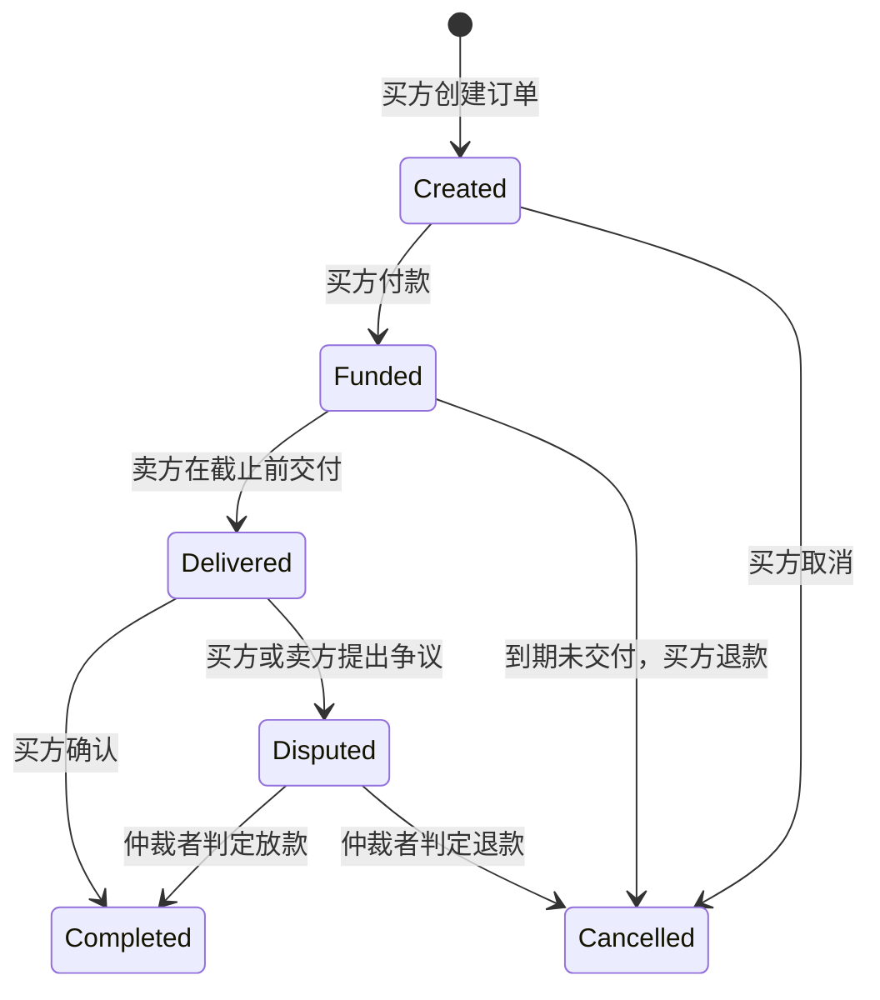

# 交付订单：权限、状态与资产流

同一业务由四种语言实现，便于比较 Solidity/Vyper 的 EVM 合约、Rust 状态机与 Move 资源语义。示例使用整数金额，不使用浮点数。

| 操作 | 角色 | 前置条件 | 资金变化 |
|---|---|---|---|
| create / constructor | 买方 | 三方角色不同、非零价格、期限 1 秒至 30 天 | 无 |
| fund | 买方 | Created 且未到期 | EVM 支付精确 ETH；模拟账本扣买方额度 |
| deliver | 卖方 | Funded 且未到期 | 仍在托管 |
| confirm | 买方 | Delivered | 记卖方可收取金额 |
| cancel | 买方 | Created，或 Funded 且已到期 | 未付款无转账；已付款记买方退款 |
| dispute | 买方/卖方 | Delivered | 冻结在托管状态 |
| resolve | 仲裁者 | Disputed | 根据判定记卖方放款或买方退款 |
| withdraw | EVM 收款人 | 自己的 credits 大于零 | 清零待收款，再转 ETH；失败整体回滚 |

## 不变量

- 订单只能结算一次；Completed / Cancelled 后不能再付款、交付或确认。
- Funded / Delivered / Disputed 的订单金额仍属于托管，不能提前计入卖方余额。
- Solidity/Vyper：正常调用下，合约持有金额等于未结算托管加待提现金额。强制转入的额外 ETH 不属于订单额度，Demo 不提供提取多余 ETH 的功能。
- Rust/Move：初始化后的可用额度总和加未结算托管额度保持守恒；Move 管理员额外 register 属于明确的模拟额度发行。
- EVM 回滚和 Move abort 保证失败操作原子性；Rust 在修改数据前完成全部可能失败的校验。

## 四种实现的差别

Solidity 与 Vyper 每个合约对应一笔订单，使用本地 EVM 的真实 value 转移、区块时间与三方地址。结算采用主动提现，避免卖方收款失败阻断买方确认。测试中的账户为临时演示账户，无外部 RPC 或真实资金。

Rust 一个 Market 管理多笔订单，通过方法参数传入角色和时间，适合练习领域模型、错误类型、审计日志与可重复测试。它没有签名验证或链上执行能力；调用方不能将传入的账户编号视为身份认证。

Move 将多笔订单与额度存为 @demo 的资源，使用 signer 校验调用者。管理员初始化账户额度并单调推进教学时钟；余额不是 Aptos 原生币或 FungibleAsset。实际接入需要替换额度存取与时钟，并重新验证资产权限及守恒。

## 当前业务边界与后续练习

没有自动执行任务：到期退款需要买方主动调用。交付后需买方确认或任意交易方发起争议；仲裁者不响应时，争议金额会继续锁定。生产方案还需要明确的举证期限、仲裁超时与治理机制。示例不包含平台手续费、部分退款、物流签名或多人仲裁，不应直接托管真实资产。

可扩展练习：先写“交付后超时仍未确认”的失败测试，再设计自动结算权限；加入手续费前，补充全部结算路径的金额守恒断言。不要只增加新方法而忽略原有状态与资金流。
